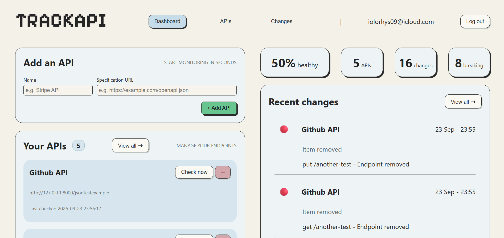
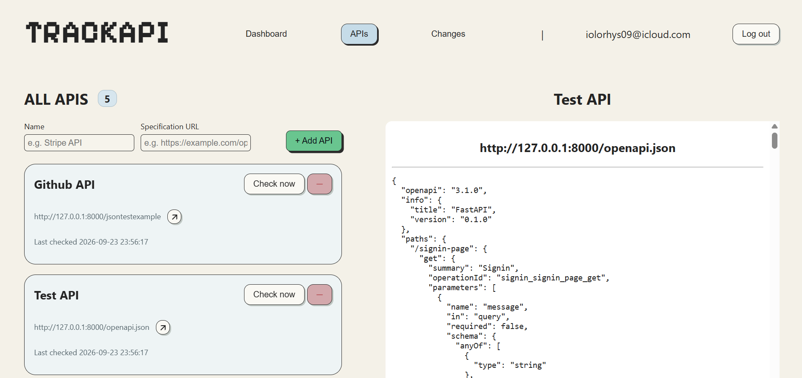
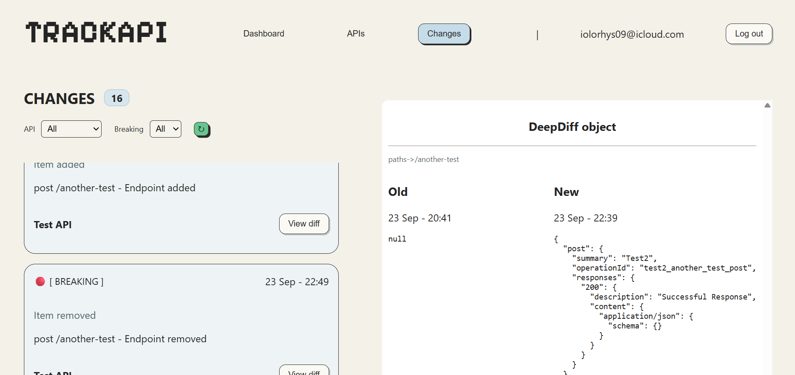

# TrackAPI

**Track OpenAPI specification changes and detect potentially breaking API updates.**

**Live website:** https://trackapi.uk

## Features

- **Automatic monitoring** – Checks registered APIs every 6 hours.
- **Manual checks** – Trigger an immediate check whenever needed.
- **Breaking change detection** – Identifies removed endpoints, HTTP methods, schema properties and other potentially breaking changes.
- **Change classification** – Categorises detected differences by their potential impact.
- **Filtering** – Browse and filter previously detected changes.
- **Email notifications** – Sends notifications about API changes.
- **API spec and DeepDiff viewing** - View the most recent OpenAPI spec for every API, and the DeepDiff objects for every change, to help developers understand the changes

## Screenshots

### Dashboard
**View APIs, recent changes, and summarised information**


### APIs
**View all your APIs and their most recent OpenAPI specifications**


### Changes
**View and filter through changes by the API and by breaking classification, and view every change's DeepDiff object**


## How It Works

TrackAPI stores snapshots of API specifications and compares them to detect changes.

1. A user registers an API by providing a URL to its OpenAPI JSON specification.
2. TrackAPI retrieves the specification and stores a snapshot in its database.
3. A background worker periodically retrieves the latest specification.
4. DeepDiff compares the latest specification against the previous snapshot.
5. Changes are classified as breaking, potentially breaking or Non-Breaking.
6. The results are stored and displayed in a readable format.

## Tech Stack

| Component | Technology |
|---|---|
| Backend | Python, FastAPI |
| HTTP requests | HTTPX |
| Specification comparison | DeepDiff |
| Database | SQLite |
| Frontend | HTML, CSS, Jinja2 |
| Application server | Gunicorn, Uvicorn |
| Reverse proxy | Traefik |
| Containerisation | Docker, Docker Compose |
| Hosting | DigitalOcean |

## Architecture

TrackAPI runs as multiple Docker containers, separating the web application from the automatic monitoring process.

The FastAPI backend handles user requests, API management and change history. A separate Python worker performs scheduled specification checks. Both components use a SQLite database to persist API registrations, specification snapshots and detected changes.

Traefik handles incoming HTTPS traffic and routes requests to the backend.

## Running Locally

TrackAPI can be run locally using Docker Compose.

### Prerequisites

- [Docker](https://www.docker.com/products/docker-desktop/)
- [Git](https://git-scm.com/)

### 1. Clone the Repository

```bash
git clone https://github.com/USERNAME/TrackAPI.git
cd TrackAPI
```

### 2. Configure Environment Variables

Create a `.env` file in the project's root directory using the provided `.env.example` file.

On Windows PowerShell:

```powershell
Copy-Item .env.example .env
```

Open `.env` and configure the required environment variables.

Never commit your `.env` file or real API keys to version control.

### 3. Configure Local Access

The production deployment uses Traefik for HTTPS routing. For local development, the FastAPI application can be accessed directly.

Create a file named `compose.override.yaml` in the project root with the following configuration:

```yaml
services:
  backend:
    ports:
      - "127.0.0.1:8000:8000"
```

### 4. Start TrackAPI

Build and start the backend and automatic checker containers:

```bash
docker compose up -d --build backend automatic_checker
```

### 5. Access the Application

Open your browser and navigate to:

**http://localhost:8000**

### 6. View Logs

```bash
docker compose logs -f backend automatic_checker
```

### 7. Stop TrackAPI

To stop and remove the running containers:

```bash
docker compose down
```

## Limitations

Change classification is based on predefined rules although it covers most of the possible OpenAPI spec changes, it's not guarantee that every breaking change will be detected.

Some changes may require manual review to determine their actual impact on API consumers.
